# TransMog how-to guide

A walkthrough of each thing TransMog does, with pictures from a test character. Everything here shows on your screen
only. For the command list and setup, see the [README](README.md).

Open the window with `/tm`. The menu on the left switches pages, and `/tm <page>` opens one straight away
(`/tm colors`, `/tm race`, ...).

## 1. Put on a look (Lockstyle)

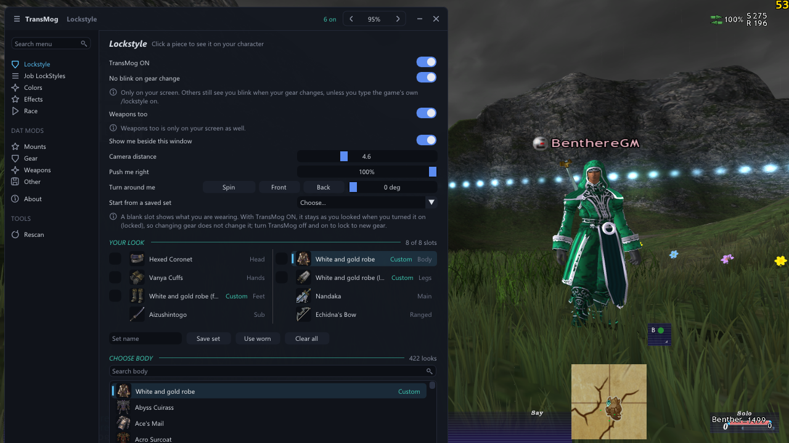

1. Open **Lockstyle** and turn on **TransMog ON**.
2. Click a slot in **Your Look** (Head, Body, Legs, ...). The list below it, **Choose**, shows every piece for that
   slot your race can wear. Type in the search box to narrow it down.
3. Click a piece. It goes on your character straight away.
4. A slot left on **Worn gear** shows what you're wearing. With TransMog ON it stays as you looked when you turned it on,
   so a job change that swaps your gear doesn't change your look. Turn TransMog off and on to lock to new gear.

Handy extras on this page:

- **Show me beside this window** turns the camera to face you, with you to the right of the window. **Camera distance**,
  **Push me right** and **Turn around me** (Spin, Front, Back) set up the view.
- **No blink on gear change** stops you vanishing for a moment when your gear changes, on your screen. **Weapons too**
  covers weapon swaps. To stop other players seeing you blink, type the game's own `/lockstyle on` yourself.
- **Use worn** fills Your Look with what you have on. **Clear all** empties it.
- After picking an armor piece, the list shows **Match this slot** and **Match full set**, to fill in the rest of
  the same set. Tick a slot's box in Your Look to match by that piece.
- A piece marked **Custom** is a look from a mod, such as the White and gold robe. A piece marked **Modified** looks
  different because a mod that's on replaces its file.

## 2. Save a look as a set

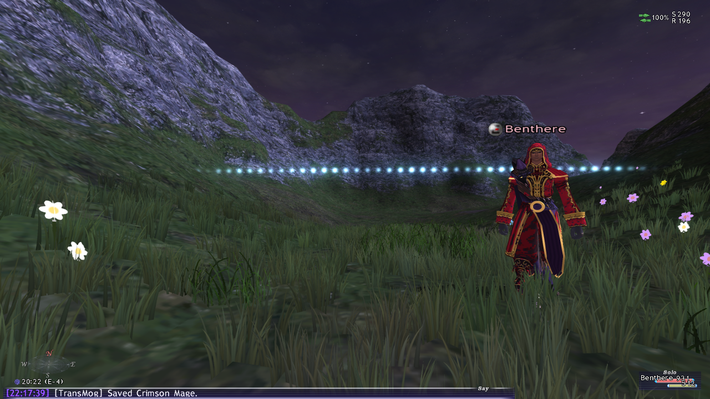

1. Build a look on the Lockstyle page.
2. Type a name in **Set name** and choose **Save set** (or type `/tm save Crimson Mage`).
3. The chat says `[TransMog] Saved Crimson Mage.`

To change a set later, pick it in **Start from a saved set**: it goes on and fills in the name, so Save set updates it.
Type a new name to keep both.

## 3. Wear a set, or give each job its own

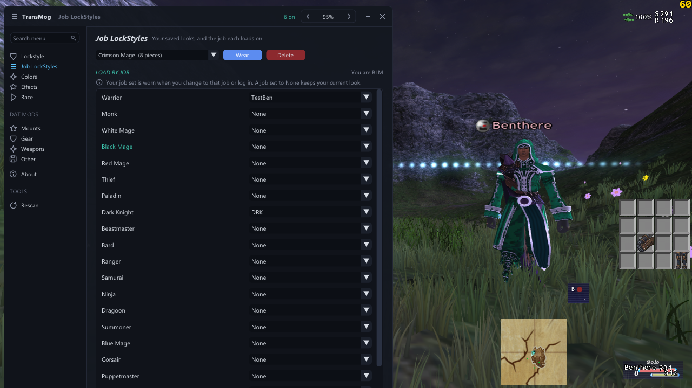

1. Open **Job LockStyles**.
2. Pick a set at the top and choose **Wear** (or type `/tm wear Crimson Mage`). **Delete** removes it.
3. Under **Load by job**, choose a set for any job. It goes on when you change to that job or log in. **None** keeps
   your current look.

Here a different saved set is worn, with the Lockstyle page showing all 8 slots filled:

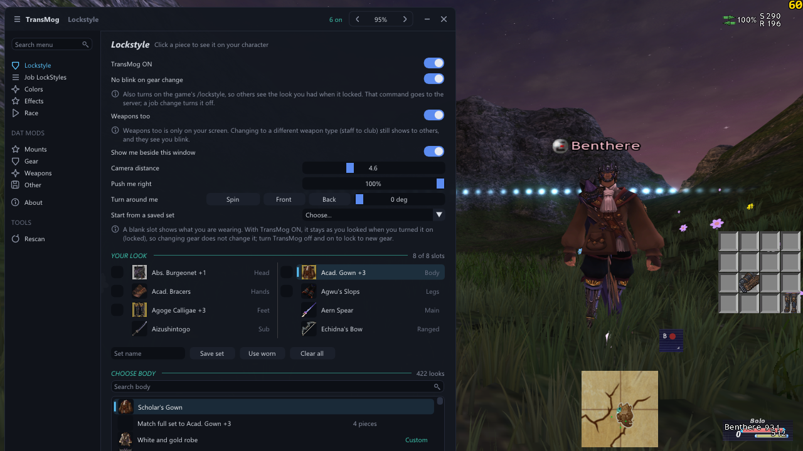

## 4. Recolor a piece, and save the colors

Open **Colors** and click the slot to recolor (Body here). It recolors whatever that slot shows in your look.

- **Quick scheme** sets every color from two: **Main** for the colored parts, and **Dark and gray parts**.
- **Each color** fine-tunes them one by one. Click a color to open its picker. Several pickers can be open at
  once, and each has a **Close** button.
- Next to every color, **Default** goes back to the piece's own color, and **Saved** to the colors you last saved.
- With **Show changes on me as I pick** on, you're redrawn in the new colors each time you let go of a picker (you
  blink for a moment). **Revert** goes back to the colors last worn, and **Defaults** to the piece's own.

To keep the colors, type a name and choose **Save**. Saved colors stay through relogging.

**Matching another piece:** say you recolored your body and want your hands to match.

1. Click **Hands**.
2. Set **Match colors from** to **Body**. Each row, in Quick scheme and in Each color, then shows the body's color on
   the left, with a **Copy** button that puts it on the hands' color next to it.
3. Choose **Use all** to copy every color at once.

Changes you haven't saved yet count too, and they're still there when you go back to the body.

**Copying one color:**
- Right-click any color to copy it, or choose **Copy** in its panel.
- Then choose **Paste** in another color's panel.
- Copy puts the color on the clipboard as `#RRGGBB`, so Paste also takes a color code you copied from anywhere else.

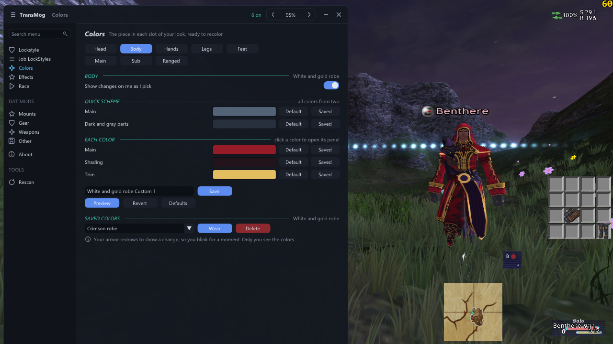

To wear colors you saved before, pick them under **Saved colors** and choose **Wear**. Here the same robe wears a
second saved scheme, green with white trim:

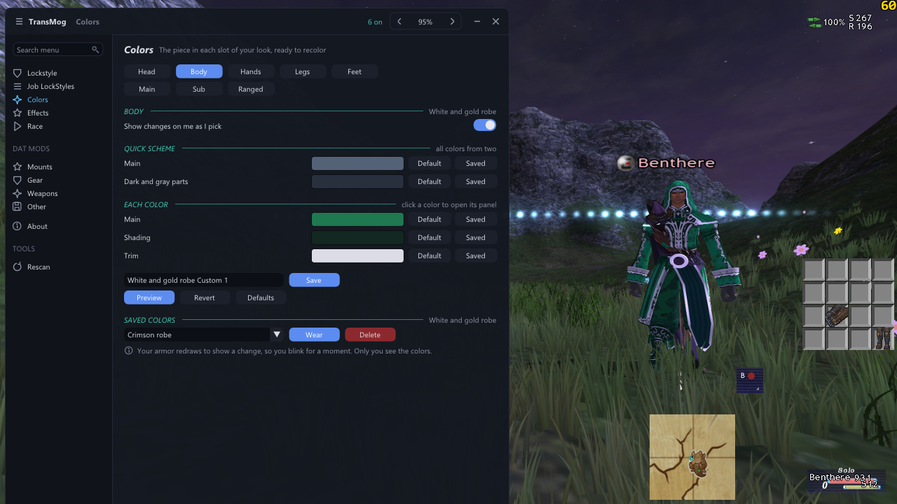

The first time you recolor a normal piece of gear, TransMog makes your own copy of it (one zone may be needed before
it shows). Your copy uses a model number no item has, so nobody else wearing that piece changes on your screen.

## 5. Wings and glows (Effects)

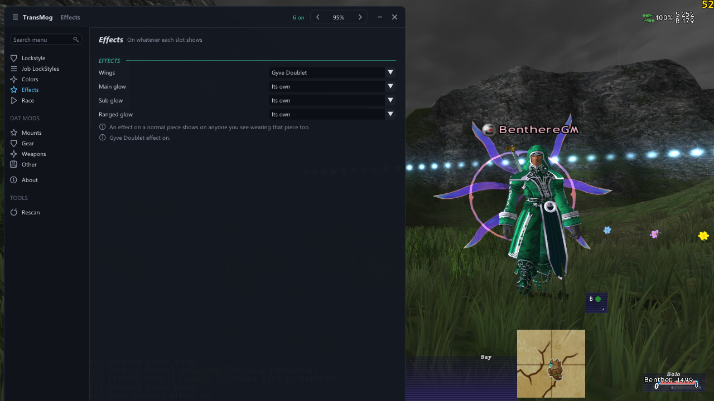

Pick **Wings** to give your body piece the wings of Gyve Doublet or Tartarus Platemail, and a **glow** for each
weapon slot from about 20 glowing weapons. **Its own** keeps the piece's own effect, and **None** removes it. Every
load starts on Its own. From a macro: `/tm effect main Coruscanti`, `/tm effect body Gyve Doublet`, or `own` / `off`.

An effect stays with the slot, so after a gear change it moves to the new piece. A piece getting an effect for the first
time usually shows it at once. After many new pieces between zones, the next ones show plain until you zone, then
with their effect.

## 6. Another race, face, hair or size

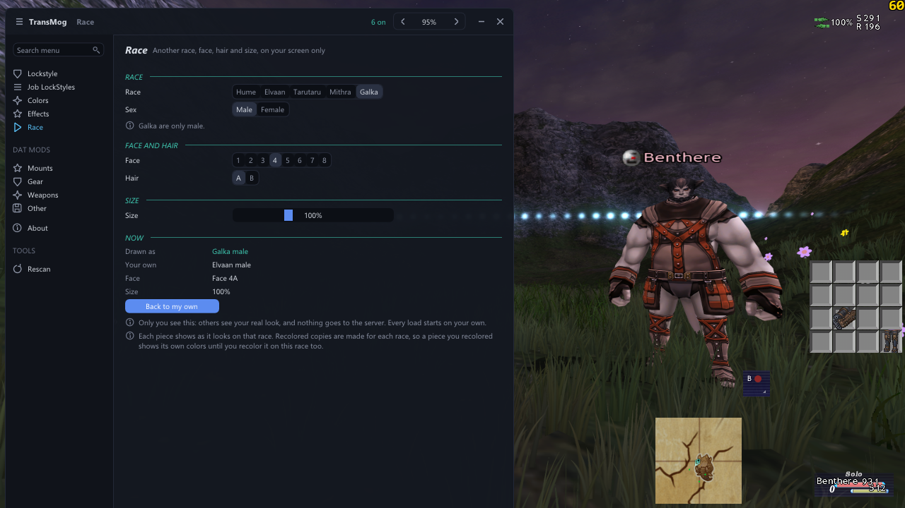

1. Open **Race** (or `/tm race`).
2. Pick a **Race** and **Sex**. Mithra are only female and Galka only male.
3. Pick a **Face** (1 to 8) and **Hair** (A or B).
4. Drag **Size** from 50% to 200%.
5. **Now** shows what you're drawn as next to your own. **Back to my own** undoes it all.

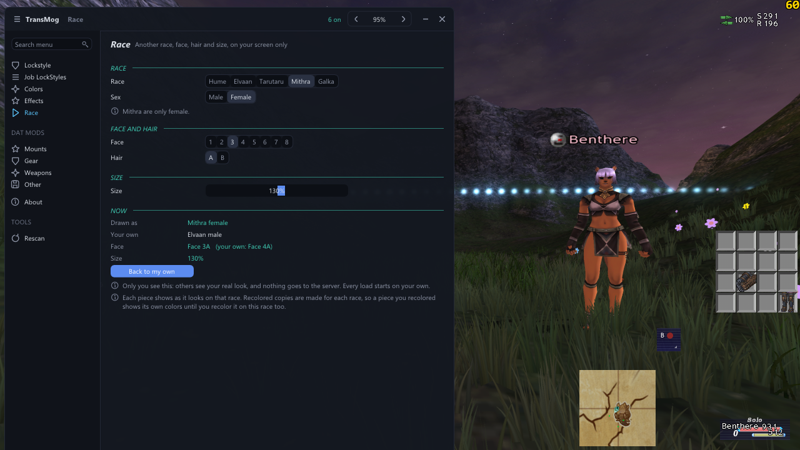

The same works from macros: `/tm race galka`, `/tm face 3a`, `/tm size 130`, and `own` to go back
(`/tm race own`). Every load starts on your own race.

Gear made for one race only shows on that race: the White and gold robe is made for Elvaan male, so on a Galka those
slots show your own gear instead.

## 7. Mounts

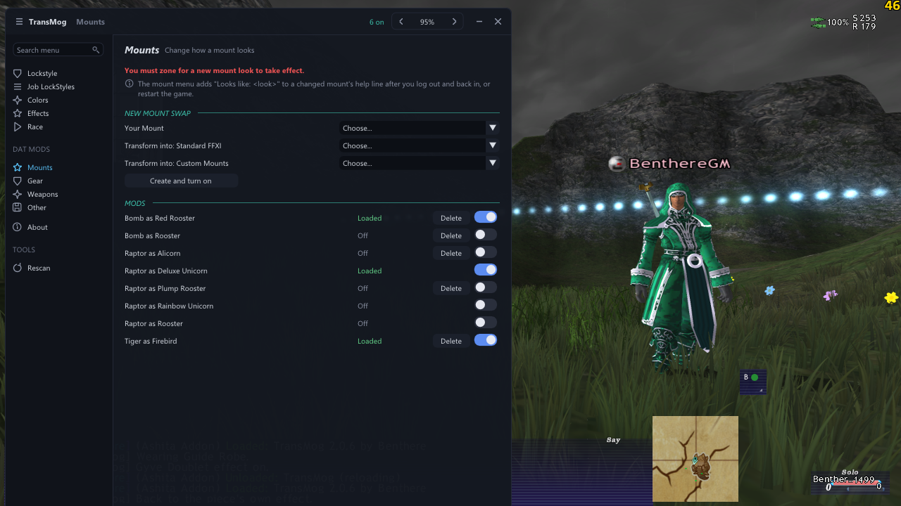

To make one of your mounts look like another:

1. Under **New Mount Swap**, pick **Your Mount**.
2. Pick its new look under **Transform into: Standard FFXI** or **Transform into: Custom Mounts** (Deluxe Unicorn,
   Red Rooster, Firebird, ...).
3. Choose **Create and turn on**, then **zone**. The new look shows after the zone.

The **Mods** list turns each swap on or off, and **Delete** removes one (click twice). A mount can only have one look,
so turning one on turns off the others for that mount. After you log out and back in, the game's mount menu says
"Looks like: &lt;look&gt;" in that mount's help line.

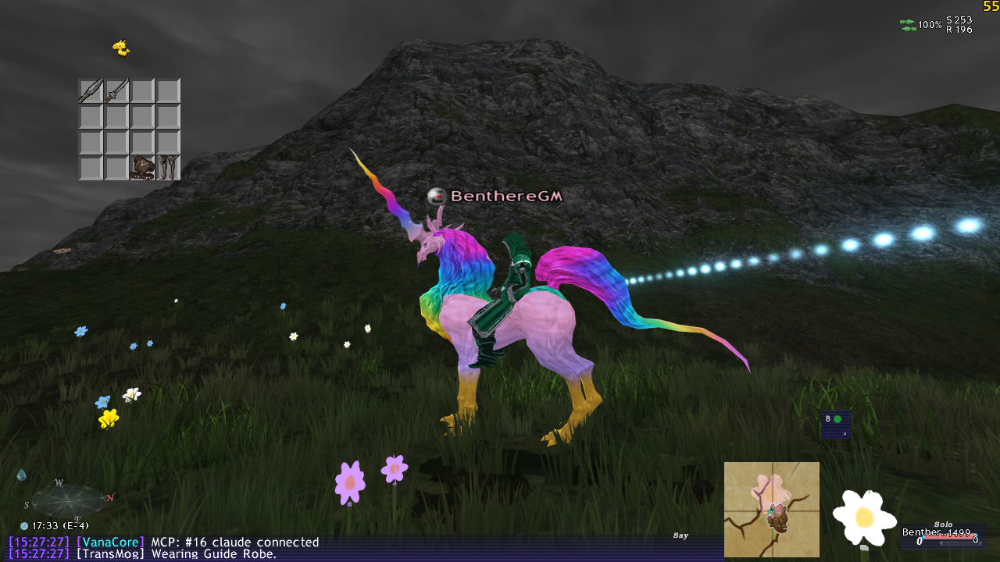

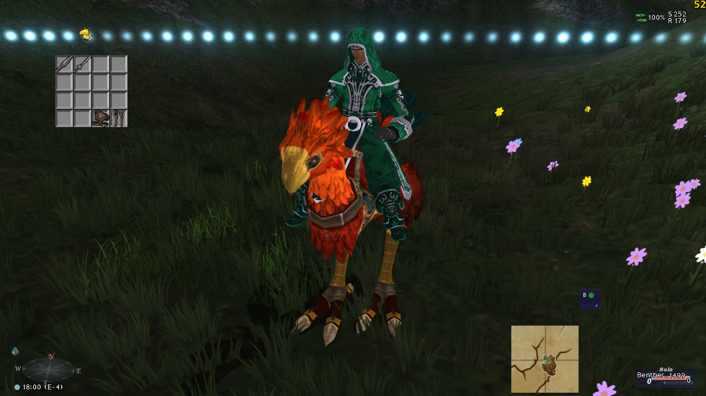

## 8. Gear, Weapons and Other mods

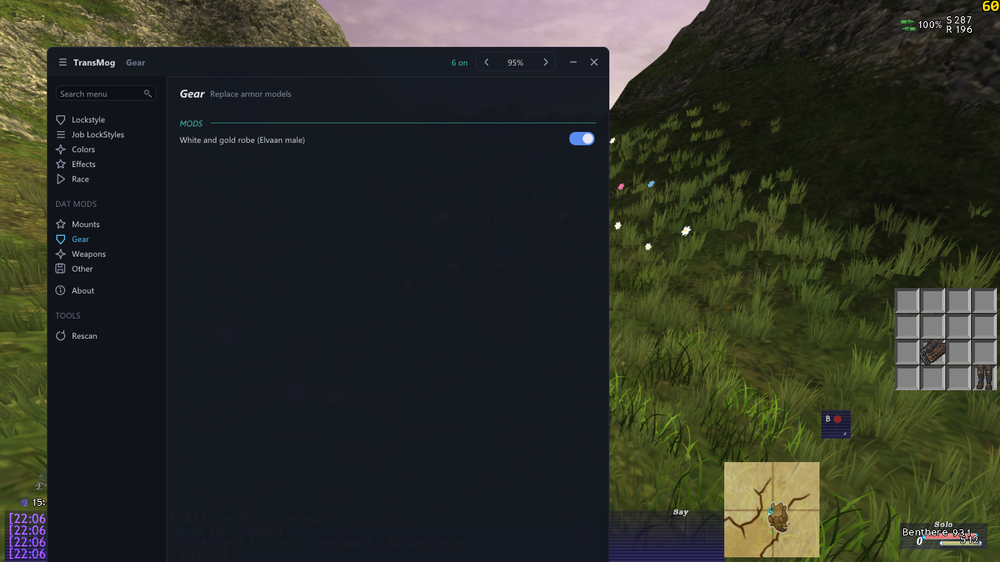

These pages list the DAT mods in each category, with a switch to turn each on or off. Zone after a change. To add
your own mod, see **Adding a mod** in the [README](README.md).

## Troubleshooting

| What you see | What to do |
|---|---|
| A mod doesn't show | Zone. If it still doesn't, check **Ignore Pivot** is unticked in the launcher |
| A slot of a look shows your own gear | That piece is made for another race, or doesn't fit the race you're drawn as |
| The Sub slot's look doesn't show | The main hand shows a two-handed weapon: like real gear, the sub hand stays empty with one |
| You blink when gear changes | Turn on **No blink on gear change**; for weapons, also **Weapons too** |
| Others see you blink | No blink is on your screen only: type the game's own `/lockstyle on` (again after a job change) |
| New colors don't show on a piece | The first recolor of a normal piece needs one zone |
| A new piece shows without its effect | Zone: it gets the effect then |
| Recolored pieces or weapons draw nothing (only your head shows) | Fixed in 2.0.3. On an older version, close the game and start it again |
| A mount's new look doesn't show | Zone: calling the mount again isn't enough |
