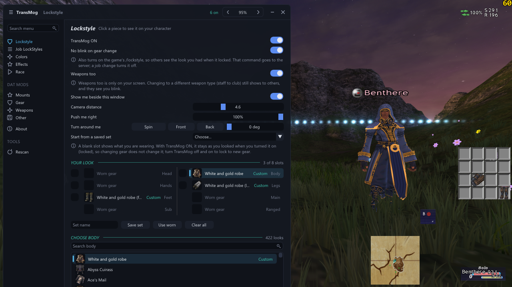

# TransMog

Change how your character and your mounts look, on your own screen only.

- **Lockstyle:** wear the look of any gear your race can wear, over what you really have on.
- **Job LockStyles:** save looks as sets, and have a set go on when you change to a job.
- **Colors:** recolor the pieces you show, and save the colors you like.
- **Effects:** put wings, or a weapon's glow, on whatever a slot shows.
- **Race:** be drawn as another race, sex, face, hair and size.
- **Mounts, Gear, Weapons, Other:** turn DAT mods on and off, and make a mount look like another one.

Other players see your real gear, race and mounts. TransMog never changes the game's own files: mods are overlays
that sit on top of them. See [GUIDE.md](GUIDE.md) for a walkthrough with pictures.



## Installing

The easy way: download `TransMog-<version>.zip` from the latest release and unzip it into your CatsEyeXI client folder
(the one holding `Vanacore` and `Ashita`). It puts the addon and the three mounts below in the right places.

By hand:

1. Put the `TransMog` folder in `Vanacore\addons\ashita\`.
2. Add `/addon load TransMog ashita` to `scripts\boot.txt`. Keep it there: the launcher resets the overlay order at each
   start, and TransMog puts your mods back when it loads.
3. Mods go in `Ashita\polplugins\DATs\TransMog\` (in this repository they're in `mods\`). Untick **Ignore Pivot** in the
   launcher, or no mod loads.

## Mounts included

Three original mounts, each a mod you turn on in the **Mounts** page, then zone. Each is also a look under **Transform
into: Custom Mounts**, so any of your mounts can wear it.

| Mod | Look | What it is |
|---|---|---|
| `mount-raptor-unicorn-deluxe` | Deluxe Unicorn | A white unicorn with a rainbow mane and tail, and gold hooves, on the Raptor |
| `mount-red-rooster` | Red Rooster | The Raptor reshaped into a plump red rooster with a curled tail |
| `mount-rooster` | Firebird | The Tulfaire repainted as a red and gold firebird |

The Deluxe Unicorn and Red Rooster both replace the Raptor, so one of them is on at a time. The scripts that built them
are in `tools\`. The White and gold robe shown in the pictures isn't included.

## Commands

| Command | What it does |
|---|---|
| `/tm` | Shows or hides the window (`/transmog` works too) |
| `/tm <page>` | Opens a page: `lockstyle`, `jobs`, `colors`, `effects`, `race`, `mounts`, `gear`, `weapons`, `other`, `about` |
| `/tm save <set>` | Saves your look as a set |
| `/tm wear <set>` | Wears a saved set |
| `/tm race <race> [sex]` | Draws you as a race: `hume`, `elvaan`, `tarutaru`, `mithra`, `galka`; `own` for your own |
| `/tm face <1a-8b>` | Your face (1 to 8) and hair (A or B); `own` for your own |
| `/tm size <50-200>` | Your size, in percent of your own; `own` for your own |
| `/tm recolor <slot>` | Makes the piece shown in a slot recolorable |
| `/tm list` | Lists the mods, and which are on |
| `/tm on <mod>`, `/tm off <mod>` | Turns a mod on or off |
| `/tm mount <mount> <look>` | Makes a mount look like another, e.g. `/tm mount Raptor Alicorn` |

The commands work in macros, so a macro can wear a set or switch your race.

## What other players see

Everything TransMog draws is on your screen only, and almost nothing goes to the server. The one exception is the
game's own `/lockstyle` command, which **No blink on gear change** sends:

- when you turn the switch on or off;
- a few seconds after a job change or logging in, while it's on, because those turn the game's lockstyle off.

That is the same command you could type yourself. It keeps others from seeing you blink when your gear changes, and
they see the look you had when it locked. Turn No blink off if you want TransMog to send nothing.

## Good to know

- **Zone after turning a mod on or off.** The game keeps loaded models until you zone, so calling a mount again isn't
  enough. The Mounts page shows Loaded, Zone to load or Zone to remove for each mod.
- **Mount names in the mount menu** pick up "Looks like: &lt;look&gt;" after you log out and back in.
- **Each character has its own look.** Looks are kept per character in `characters\<name>.json`, so two games open at
  once don't overwrite each other.
- **Every load starts on your own race and effects.** Race, face, hair, size and effects reset when TransMog loads.
  Your looks, sets and colors are kept.
- **Gear made for one race** (like the White and gold robe, made for Elvaan male) only shows on that race. On another
  race the slot shows your gear instead, so nothing goes invisible.
- **A two-handed weapon empties the sub hand.** With a great sword, polearm, staff, scythe, great axe, great katana
  or hand-to-hand showing in the main hand, the sub slot shows nothing, as with real gear. The game would otherwise
  draw the weapon low, on the ground.
- **Recolored pieces are private copies.** The first time you recolor a normal piece, TransMog copies it to a model
  number no item uses, so only your character changes, not everyone wearing that piece.
- **Effects on a normal piece** show on anyone you see wearing that piece.

## Adding a mod

Put a folder in `Ashita\polplugins\DATs\TransMog\`, laid out like the FFXI folder (`ROM\351\101.DAT`). Any XIPivot
mod works as it is. To name it and put it under a page, add a `transmog.json`:

```json
{ "title": "Red sword", "category": "weapon" }
```

Categories are `mount`, `gear`, `weapon` and `other`. If two mods that are on change the same file, the page says so.

A mod can add looks of its own, which appear in the Lockstyle lists marked **Custom**:

```json
{ "title": "My robe", "category": "gear",
  "looks": [ { "slot": "body", "model": 443, "race": 3, "name": "My robe", "icon": 13749, "hides": ["head"] } ] }
```

`race` is the race the model was made for (1 Hume male to 8 Galka), `icon` is an item id, and `hides` lists slots the
look covers, such as a hood over the head. A mount mod names the look it gives with `"look": "Rooster"`.

## Files

| Path | What it holds |
|---|---|
| `TransMog.lua` | The window |
| `transmog_core.lua` | Looks, mods, races and everything that touches the game |
| `transmog_colors.lua` | Recoloring and effects in DAT files |
| `vcmenu.lua` | The window's style, matching VanaCore's own menus |
| `effects.json` | The wings and glows the Effects page offers |
| `characters\` | Each character's look |
| `tools\` | Python scripts that built the custom mounts and the robe |
| `docs\` | The pictures in this README and the guide |
